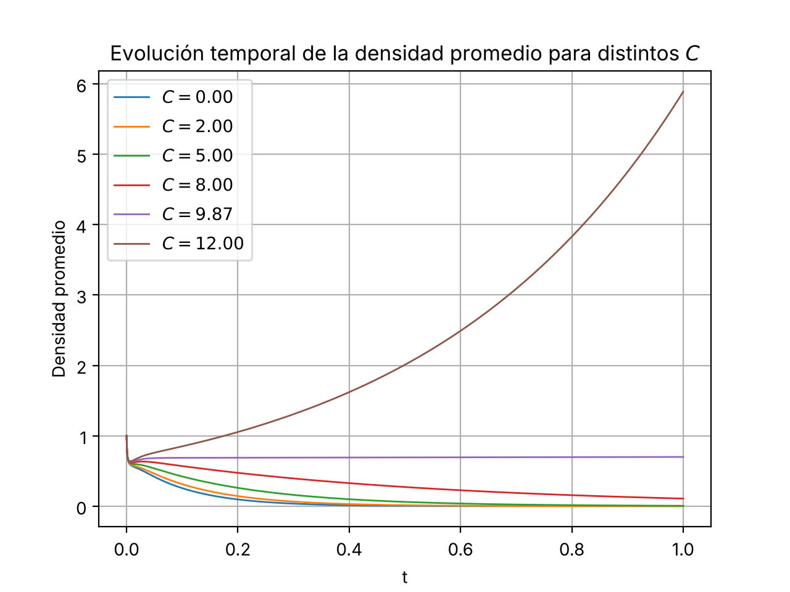
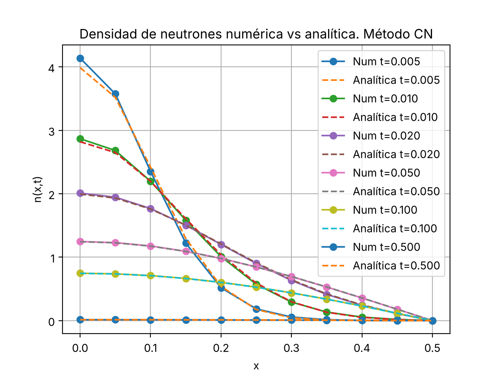
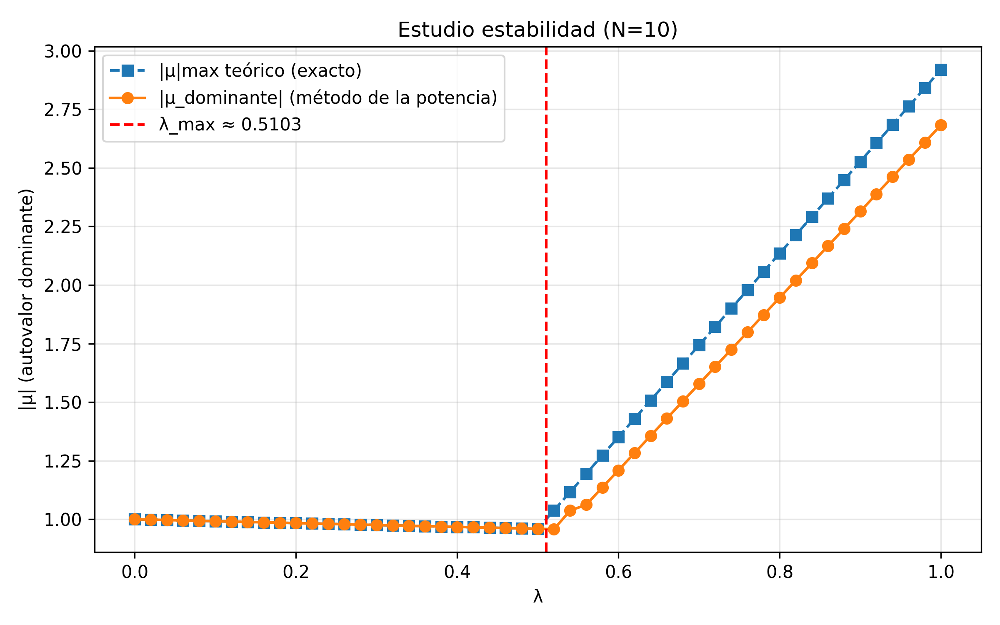
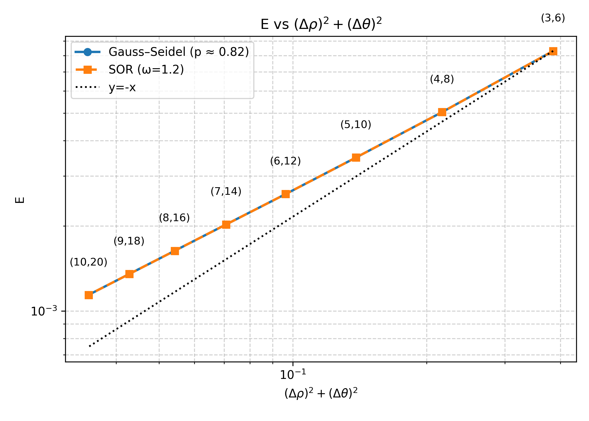
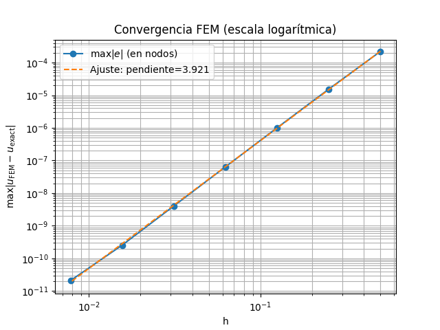

# Numerical methods for ODEs and PDEs

Finite-difference, iterative and finite-element solvers for boundary-value problems, heat conduction and diffusion. Every solver is checked against an analytic solution, and each part includes convergence studies. Written in Python (NumPy, Matplotlib) for the Advanced Numerical Methods course of the M.Sc. in Advanced Physics (Computational Physics), UNED.


*Diffusion with a source term, solved with Crank–Nicolson. The average density decays for C < π², stays constant at the critical value C = π² ≈ 9.87, and grows exponentially above it, as theory predicts for D = L = 1.*

| Folder | Problem | Methods | Validation |
|---|---|---|---|
| [`01-boundary-value-problems`](01-boundary-value-problems) | Linear 2nd-order BVP, y″ = −(1 + (x−1)²) y − 1, Dirichlet BCs | Finite differences (tridiagonal Crout solver); linear shooting with RK4 | The two methods agree; error vs. mesh size |
| [`02-eigenvalues-explicit-scheme-stability`](02-eigenvalues-explicit-scheme-stability) | Eigenvalues of tridiag(λ, 1−2λ, λ), the iteration matrix of the explicit heat-equation scheme | QR algorithm with and without shifts; power method with Aitken acceleration | Exact eigenvalues 1 − 2λ + 2λ cos(kπ/(N+1)); stability limit λ_max ≈ 0.51 (N = 10) |
| [`03-steady-heat-conduction-polar`](03-steady-heat-conduction-polar) | Steady temperature in a semicircular plate: Laplace's equation in polar coordinates, diameter and arc held at fixed temperatures | 5-point finite-difference stencil in (ρ, θ); Gauss–Seidel and SOR (ω = 1.2) | Exact series solution; mean error vs. mesh refinement |
| [`04-diffusion-explicit-vs-crank-nicolson`](04-diffusion-explicit-vs-crank-nicolson) | 1D neutron diffusion with a source, ∂n/∂t = D ∂²n/∂x² + C n, initial delta pulse, absorbing walls | Explicit (FTCS) and Crank–Nicolson schemes | Exact Fourier-series solution; spatial and temporal convergence; criticality at C = π²D/L² |
| [`05-finite-elements-galerkin`](05-finite-elements-galerkin) | u″ + u = −x, u(0) = 0, u′(1) = 0 | Galerkin FEM with linear (P1) and quadratic (P2) elements | Exact solution sin x / cos 1 − x; observed nodal order ≈ 2 (P1) and ≈ 4 (P2) |

## Results

<p>


</p>

- **Left:** Crank–Nicolson (dots) against the exact series solution (dashed) at several times, for the spreading delta pulse.
- **Right:** dominant eigenvalue of the explicit-scheme matrix from the power method against theory. Above λ ≈ 0.51 it exceeds 1, so the explicit scheme becomes unstable (the limit tends to λ = 1/2 as N grows).


*Heat conduction in the semicircular plate: mean error against the exact solution as the polar mesh (N_ρ, N_θ) is refined.*


*Finite elements with quadratic (P2) elements: the maximum nodal error falls as h^3.92.*

## Usage

Each folder is self-contained; run it from inside the folder. All scripts need Python 3.10+ (`pip install -r requirements.txt`).

```bash
# 01 – BVP: finite differences and shooting together (N = 20 and 19 subintervals)
python main.py --a 0 --b 2 --alpha 0 --beta 0 --N 20 19 --modo dos_metodos --output out

# 02 – eigenvalues: QR with shifts, power method, stability analysis
python main.py --mode qr --lam 0.2 --dim 10 --tol 1e-3 --N 10000
python main.py --mode potencia --lam 0.2 --dim 10 --tol 1e-6 --N 1000
python main.py --mode analisis --lam 0.2 --dim 10 --tol 1e-3 --N 1000

# 03 – heat conduction: one mesh, or the mesh-refinement study
python main.py --N_i 3 --N_j 6 --T0 -10 --T1 90 --modo simple --ruta_output out
python main.py --N_i 3 --N_j 6 --T0 -10 --T1 90 --modo varios_mallados --ruta_output out/

# 04 – diffusion: solve and compare, convergence in space, criticality sweep in C
python main.py --mode calculo --L 1 --D 1 --C 0 --T_final 0.5 --N_div_x 20 --N_div_t 5000 --output_path out
python main.py --mode convergencia --T_final 0.1 --N_div_t 6000 --Nxs "5,10,20,40,80" --N_modes 800 --output_path out
python main.py --mode general_C --T_final 1 --N_div_x 20 --N_div_t 5000 --Cs "0,2,5,8,9.8696,12" --output_path out

# 05 – finite elements: linear or quadratic elements
python main.py lineal
python main.py cuadratico
```

Code comments and plot labels are in Spanish.
